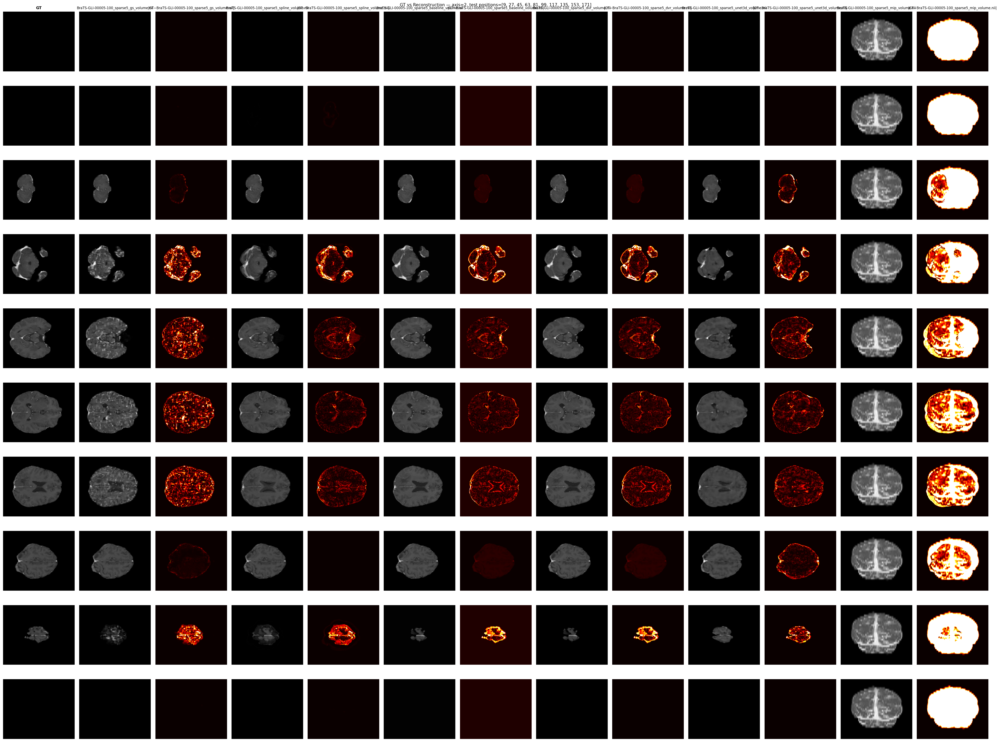
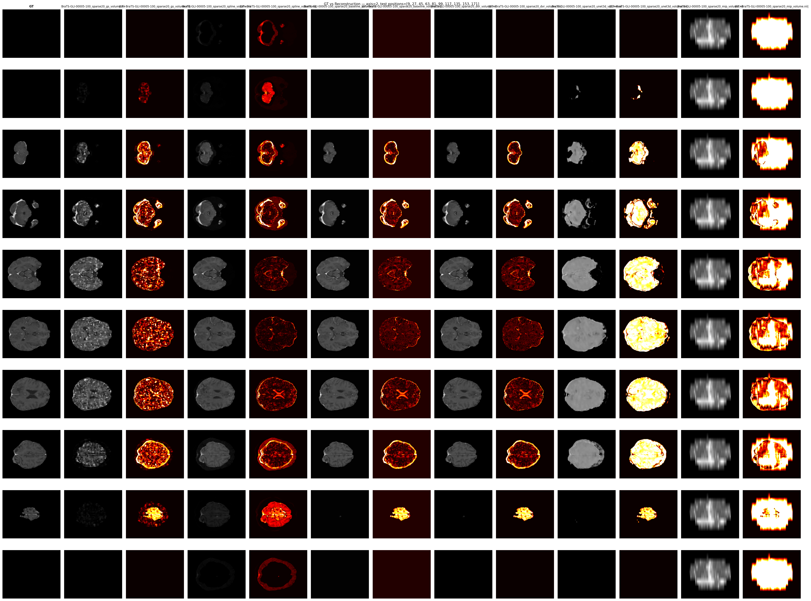
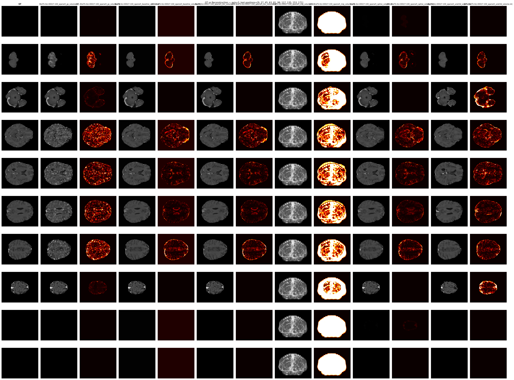
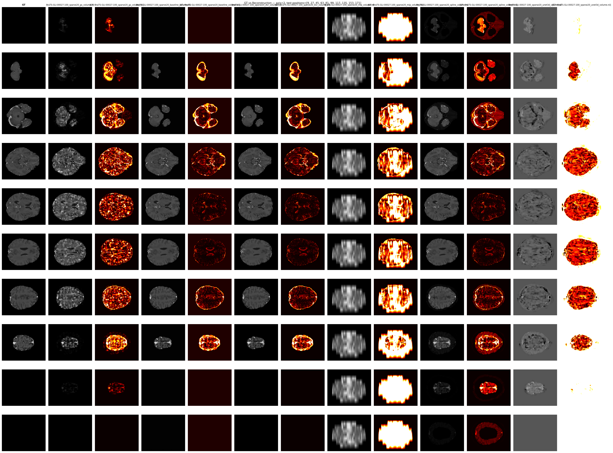
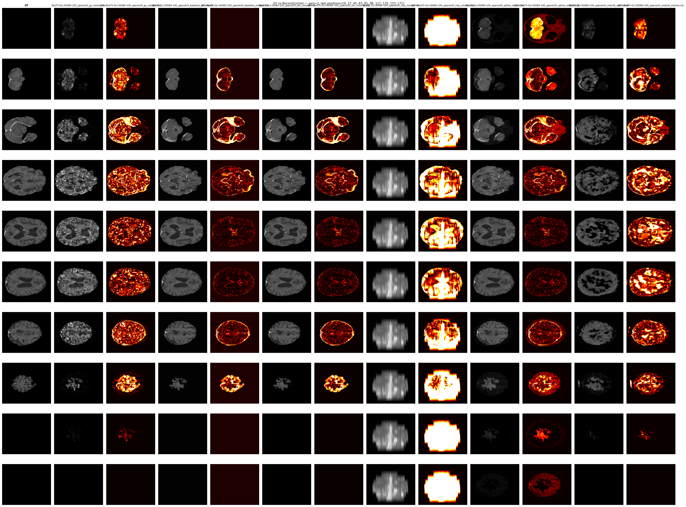
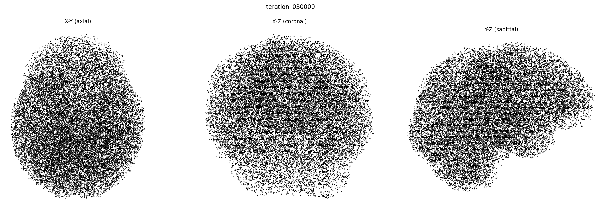
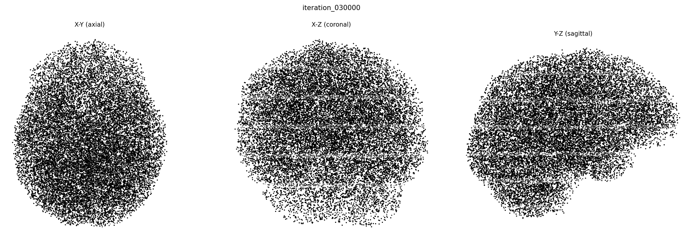
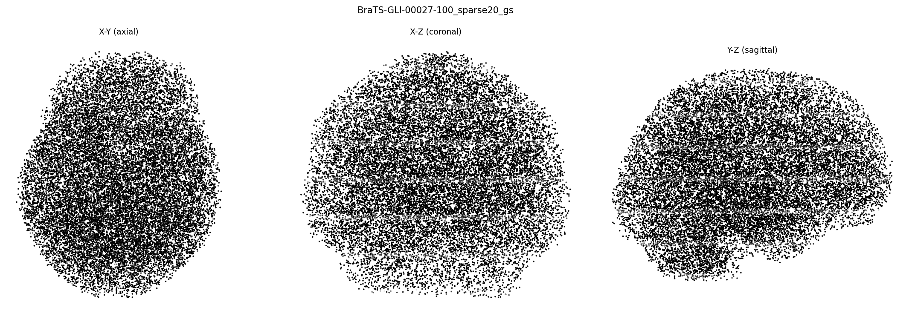
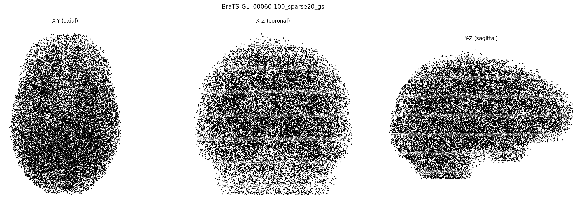

# MedVision3D: Interactive 3D Visualization from MRI Slices Using Gaussian Splatting

**EECS 504 — Computer Vision, Winter 2026**

## 1. Introduction

Medical imaging, particularly MRI, generates volumetric data as a stack of 2D slices. Traditional volume rendering methods (direct volume rendering, maximum intensity projection) provide basic visualization but lack the ability to interpolate between acquired slices or produce high-fidelity novel views. This project adapts **3D Gaussian Splatting (3DGS)** — originally designed for photogrammetric scene reconstruction — to MRI volume reconstruction, replacing RGB color with scalar tissue intensity and rendering fixed slice planes instead of arbitrary camera views.

### Motivation

- MRI scans are often acquired with anisotropic resolution (thick slices with gaps), and clinicians need high-quality interpolation between slices for diagnosis.
- 3DGS offers an explicit, differentiable representation that is compact and fast to render, making it a promising candidate for volumetric medical data.
- Compared to implicit neural representations (e.g., NeRF), Gaussian Splatting provides interpretable primitives and real-time rendering.

### Goals

| Target | Metric |
|--------|--------|
| Reconstruction quality | PSNR > 30 dB on held-out slices |
| Structural similarity | SSIM > 0.90 |
| Rendering speed | >= 30 FPS at 480 x 480 |

## 2. Method

### 2.1 Data

We use the **BraTS-GLI 2023** glioma dataset, each containing four MRI modalities (T1c, T1n, T2f, T2w) and segmentation masks as NIfTI volumes. All volumes have shape **(182 x 218 x 182)** with 1 mm isotropic voxel spacing. We focus on the T1c (post-contrast T1-weighted) modality and evaluate across three cases:

- **BraTS-GLI-00005-100**
- **BraTS-GLI-00027-100**
- **BraTS-GLI-00060-100**

Each case is tested under two sparsity levels: **sparse_factor=5** (every 5th slice, ~37 training slices) and **sparse_factor=20** (every 20th slice, ~10 training slices).

### 2.2 Gaussian Representation

We adapt the standard 3DGS representation for scalar MRI data. Each Gaussian is parameterized by:

| Parameter | Shape | Description |
|-----------|-------|-------------|
| `_xyz` | (N, 3) | 3D position in voxel coordinates |
| `_scaling` | (N, 3) | Log-scale axes (anisotropic) |
| `_rotation` | (N, 4) | Unit quaternion orientation |
| `_intensity` | (N, 1) | Scalar tissue intensity (logit-encoded) |
| `_opacity` | (N, 1) | Opacity (logit-encoded) |

The key modification from standard 3DGS is replacing the **(N, 3)** RGB color with a **(N, 1)** scalar intensity, reflecting the single-channel nature of MRI data.

### 2.3 Rendering Pipeline

The volume renderer (`VolumeRenderer`) generates a 2D slice image from the 3D Gaussian scene:

1. **Cull** — Discard Gaussians farther than 3-sigma from the target slice plane
2. **Project** — Map surviving 3D Gaussians to 2D in-plane coordinates
3. **Sort** — Depth-sort along the slice axis (front-to-back)
4. **Composite** — Alpha-blend:

   I(x,y) = sum_i alpha_i * intensity_i * prod_{j<i}(1 - alpha_j)

The renderer supports CUDA-accelerated rasterization via `diff-gaussian-rasterization` with a pure PyTorch fallback.

### 2.4 Baseline Methods

We compare GS against five baselines:

| Method | Type | Description |
|--------|------|-------------|
| **Cubic Spline** | Non-learned | Scipy cubic spline interpolation along the slice axis |
| **Baseline Voxel Grid** | Learned | Dense voxel grid (7.2M params) trained to minimize L1 on training slices |
| **3D U-Net Interp** | Learned | Lightweight 3D U-Net (340K params) with masked autoencoding |
| **Direct Volume Rendering (DVR)** | Non-learned | Nearest-neighbour slice lookup from training stack |
| **Max Intensity Projection (MIP)** | Non-learned | Maximum intensity along the slice axis |

## 3. Training

### 3.1 Gaussian Splatting

- **100,000 Gaussians** initialized inside the MRI volume, weighted by voxel intensity.
- Adam optimizer with per-parameter learning rates (position: 1.6e-4 with exponential decay, intensity: 2.5e-3, opacity: 5e-2, scaling: 5e-3, rotation: 1e-3).
- Loss: L1 + 0.2 * DSSIM (following Kerbl et al. 2023).
- Adaptive density control (iterations 500-15000): clone/split high-gradient Gaussians, prune low-opacity ones, reset opacity every 3000 iterations.
- **30,000 iterations** per case.

### 3.2 3D U-Net Interpolation

- TinyUNet3D with 339,569 parameters (base channels = 16).
- Masked autoencoding: each iteration masks ~1/6 of training slices, builds linearly-interpolated input from visible slices, and trains to predict the masked slices.
- Adam optimizer with cosine annealing (LR 1e-3 -> 1e-5).
- **10,000 iterations** per case.

### 3.3 Training Configurations

| Config | Train slices | Holdout slices | Scenario |
|--------|:---:|:---:|---------|
| **Sparse-5** | 37 | 145 | Moderate undersampling (5x) |
| **Sparse-20** | 10 | 172 | Aggressive undersampling (20x) |

## 4. Results

All methods are evaluated on **held-out slices only** — slices the model has never seen during training. This ensures a fair comparison of interpolation capability.

### 4.1 Per-Case Results (PSNR in dB)

#### Sparse-5 (37 training slices, 145 holdout)

| Case | GS | Spline | Baseline | UNet | DVR | MIP |
|------|:---:|:---:|:---:|:---:|:---:|:---:|
| BraTS-GLI-00005-100 | **44.34** | 44.12 | 33.25 | 32.65 | 31.92 | 12.53 |
| BraTS-GLI-00027-100 | **43.37** | 41.40 | 32.47 | 30.55 | 30.78 | 11.96 |
| **Average** | **43.85** | 42.76 | 32.86 | 31.60 | 31.35 | 12.25 |

#### Sparse-20 (10 training slices, 172 holdout)

| Case | GS | Spline | Baseline | UNet | DVR | MIP |
|------|:---:|:---:|:---:|:---:|:---:|:---:|
| BraTS-GLI-00005-100 | **35.86** | 30.69 | 29.90 | 28.54 | 28.04 | 12.99 |
| BraTS-GLI-00027-100 | **32.78** | 28.03 | 28.17 | 19.48 | 24.75 | 12.31 |
| BraTS-GLI-00060-100 | **29.83** | 27.53 | 27.69 | 24.04 | 24.57 | 11.90 |
| **Average** | **32.82** | 28.75 | 28.58 | 24.02 | 25.79 | 12.40 |

#### Overall Average (all 5 case-sparsity combinations)

| Method | Avg PSNR (dB) | Parameters | Avg FPS |
|--------|:---:|:---:|:---:|
| **Gaussian Splatting** | **37.24** | ~98K | 7.6 |
| Cubic Spline | 34.35 | 0 | 495 |
| Baseline Voxel Grid | 30.30 | 7.2M | 1.0 |
| 3D U-Net Interp | 27.05 | 340K | 182 |
| Direct Volume Rendering | 28.01 | 0 | 5,303 |
| Max Intensity Projection | 12.34 | 0 | 3,816 |

### 4.2 Key Findings

1. **GS consistently ranks first** across all cases and sparsity levels, with an overall average of 37.24 dB — 2.89 dB above the next best method (Cubic Spline at 34.35 dB).

2. **The GS advantage grows with sparsity.** At sparse-5, GS leads Spline by only 1.09 dB (43.85 vs 42.76). At sparse-20, the gap widens to 4.07 dB (32.82 vs 28.75). This suggests that GS's learned 3D representation generalizes better across large slice gaps than analytical interpolation.

3. **Cubic Spline is a strong non-learned baseline.** At sparse-5 it nearly matches GS, demonstrating that the 5x undersampling problem is well-conditioned for smooth interpolation. It degrades more steeply at sparse-20 where slice gaps are large enough to violate smoothness assumptions.

4. **U-Net struggles at sparse-20.** The 3D U-Net achieves reasonable results at sparse-5 (31.60 dB) but collapses to 24.02 dB at sparse-20. With only 10 training slices and 340K parameters, the model overfits: training loss frequently drops to 0.000 while holdout performance is poor. The case BraTS-GLI-00027-100 sparse-20 is particularly bad (19.48 dB).

5. **GS is 73x more compact than the Voxel Grid** (~98K vs 7.2M parameters) while achieving 6.94 dB higher PSNR on average.

6. **Rendering speed:** GS at ~7.6 FPS does not meet the 30 FPS target. DVR and MIP achieve thousands of FPS (non-learned lookups), Spline ~495 FPS, and UNet ~182 FPS. The GS renderer is bottlenecked by per-slice culling, projection, and alpha-compositing of ~98K Gaussians.

### 4.3 PSNR Inflation Note

BraTS volumes contain ~30 slices at each end of the axial axis that are entirely outside the brain (pure background). When both GT and prediction are near zero, per-slice PSNR becomes very large and inflates the mean. All methods are equally affected, so the **ranking is preserved**, but absolute PSNR values should be interpreted with this caveat. A brain-masked PSNR would lower all numbers.

### 4.4 Qualitative Results

#### BraTS-GLI-00005-100

| Sparse-5 | Sparse-20 |
|-----------|-----------|
|  |  |

#### BraTS-GLI-00027-100

| Sparse-5 | Sparse-20 |
|-----------|-----------|
|  |  |

#### BraTS-GLI-00060-100

| Sparse-20 |
|-----------|
|  |

*Each figure shows 10 held-out test slice positions. Columns: GT | GS | |GT-GS| | Baseline | |GT-Baseline| | DVR | |GT-DVR| | MIP | |GT-MIP| | Spline | |GT-Spline| | UNet | |GT-UNet|. Error maps use a hot colormap clipped at 0.3.*

#### Gaussian Point Clouds

| Case | Sparse-5 | Sparse-20 |
|------|----------|-----------|
| 00005 |  |  |
| 00027 |  |  |
| 00060 | — |  |

*3-view scatter plots of Gaussian centres (subsampled to 20K), coloured by intensity x opacity.*

### 4.5 Storage Efficiency

| Method | Parameters | On-disk size |
|--------|----------:|-------------:|
| **Gaussian Splatting** | ~98K | ~5.2 MB (PLY) |
| 3D U-Net Interp | 340K | ~1.3 MB (PT) |
| Baseline Voxel Grid | 7.2M | ~28 MB (PT) |
| Raw NIfTI volume | 7.2M voxels | ~14 MB (.nii.gz) |

GS achieves the highest reconstruction quality with 73x fewer parameters than the voxel grid — a compact, differentiable, and re-renderable representation.

## 5. Discussion

### What works well

1. **GS generalizes across cases.** Three different BraTS cases with varying anatomy all show the same pattern: GS > Spline > Baseline >= DVR >> MIP.
2. **GS handles aggressive sparsity gracefully.** Even at 20x undersampling (10 slices), GS produces coherent reconstructions (29.8-35.9 dB) while learned baselines degrade sharply.
3. **The 3D Gaussian representation is interpretable.** Point cloud visualizations show Gaussians concentrating in tissue-rich regions, providing geometric insight into the reconstruction.
4. **Training is stable.** Across all cases, GS training converges reliably in 30K iterations without manual tuning. Gaussian count stabilizes around 97-99K through adaptive density control.

### Limitations

1. **Rendering speed.** GS at ~7.6 FPS falls short of the 30 FPS target. This is fundamentally limited by per-slice Gaussian culling and alpha-compositing of ~98K primitives.
2. **PSNR inflation from background slices.** Absolute PSNR values are higher than brain-region-only performance. A brain-masked metric would give more clinically meaningful numbers.
3. **Single modality.** All experiments use T1c only. Multi-modality (T1n, T2f, T2w) and multi-channel GS (N,4 intensity) remain untested.
4. **U-Net overfitting at sparse-20.** With only 10 training slices, the masked autoencoding approach cannot regularize 340K parameters effectively. A smaller model or stronger augmentation may help.
5. **BraTS-GLI-00060-100 sparse-5 not yet completed.** This case is still running and will be added when available.

## 6. Environment

| Component | Specification |
|-----------|---------------|
| Dataset | BraTS-GLI 2023 |
| Cases | BraTS-GLI-00005-100, 00027-100, 00060-100 |
| Modality | T1c (post-contrast T1-weighted) |
| Volume shape | 182 x 218 x 182, 1 mm isotropic |
| GPU | NVIDIA A40 48 GB |
| Framework | PyTorch + diff-gaussian-rasterization (CUDA) |
| Platform | Great Lakes HPC (SLURM) |

## 7. Reproduction

```bash
# Setup
conda env create -f environment.yml
conda activate medvision3d
bash scripts/setup_env.sh

# Train GS (sparse-5)
python train.py case_id=BraTS-GLI-00005-100 sparse_factor=5

# Train GS (sparse-20)
python train.py case_id=BraTS-GLI-00005-100 sparse_factor=20

# Train U-Net baseline
python train.py case_id=BraTS-GLI-00005-100 sparse_factor=5 model_type=unet

# Benchmark all methods
python compare.py case_id=BraTS-GLI-00005-100 sparse_factor=5

# Visualize
python visualize.py compare outputs/comparisons/BraTS-GLI-00005-100_sparse5_gs_volume.nii.gz \
    --gt ../Data/BraTS-GLI/train/BraTS-GLI-00005-100/BraTS-GLI-00005-100-t1c.nii.gz \
    --also outputs/comparisons/BraTS-GLI-00005-100_sparse5_baseline_volume.nii.gz \
    --also outputs/comparisons/BraTS-GLI-00005-100_sparse5_dvr_volume.nii.gz \
    --also outputs/comparisons/BraTS-GLI-00005-100_sparse5_mip_volume.nii.gz \
    --also outputs/comparisons/BraTS-GLI-00005-100_sparse5_spline_volume.nii.gz \
    --also outputs/comparisons/BraTS-GLI-00005-100_sparse5_unet3d_volume.nii.gz \
    --save
```